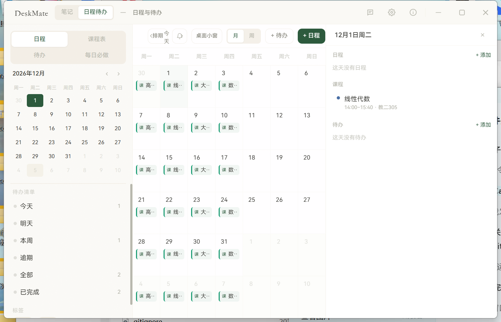

<!-- markdownlint-disable -->

**简体中文** | [繁體中文](README_zh-HK.md) | [English](README_en-US.md)

<div align="center">


# DeskMate

本地优先的课表、日程与待办桌面应用<br>
零账号 · 零云端 · 数据全部留在自己的电脑上<br>
基于 Tauri 2 + React + Rust 构建

[反馈问题](https://github.com/Ahazjh/DeskMate/issues) · [更新日志](https://github.com/Ahazjh/DeskMate/releases)<br>
[下载安装](#下载安装) · [功能特点](#功能特点) · [从源码构建](#从源码构建)

[](https://github.com/Ahazjh/DeskMate/releases/latest)
[](LICENSE)
</br>


[](https://deepwiki.com/Ahazjh/DeskMate)

</div>

<!-- markdownlint-restore -->

---

## 为什么选择 DeskMate

市面上的笔记、日历与待办工具往往要注册账号、引导流程长、启动也慢。DeskMate 把「随手记」和「课程表 / 日程 / 待办」放进同一个本地窗口：呼出即用，关闭即走，不依赖任何服务。

## 功能特点

- **Markdown 笔记** — GitHub Flavored Markdown、LaTeX 公式、实时预览、分类管理、`.md` 导入导出
- **快捷便签与磁贴** — 全局快捷键（默认 `Ctrl+Space`）呼出便签，可把笔记固定成桌面磁贴
- **课程表** — 周次与单双周、调课 / 停课、时间轴与表格视图、打印 / 导出 PDF、文本快速导入
- **双人课表** — 导入对方的课表，双方课程占满同一时段重叠显示，五种关系专属图标，自动标出共同空档
- **日程与待办** — 时间块日程、截止待办、逾期分组、智能排期、DDL 压力条、每日必做与连续打卡
- **桌面小窗** — 一个「今日一览」窗口上下同时显示日程与待办，四档字号、置顶、位置记忆，启动自动恢复
- **深浅色主题** — 以点击的按钮为圆心圆形扩散切换，尊重系统的「减少动态效果」设置
- **本地提醒** — 课程 / 日程 / 待办到点提醒，无需联网




## 下载安装

**目前仅提供 Windows x64 版本**（Windows 10 / 11，需系统已安装 WebView2 Runtime；Win11 通常自带）。

请前往 [GitHub Releases](https://github.com/Ahazjh/DeskMate/releases/latest) 下载：

| 文件 | 说明 |
| --- | --- |
| [DeskMate_1.2.0_x64-setup.exe](https://github.com/Ahazjh/DeskMate/releases/download/v1.2.0/DeskMate_1.2.0_x64-setup.exe) | 安装版（推荐）：创建开始菜单与桌面快捷方式 |
| [DeskMate_1.2.0_x64_portable.exe](https://github.com/Ahazjh/DeskMate/releases/download/v1.2.0/DeskMate_1.2.0_x64_portable.exe) | 便携版：单个 exe，放到任意目录直接运行 |
| [SHA256SUMS.txt](https://github.com/Ahazjh/DeskMate/releases/download/v1.2.0/SHA256SUMS.txt) | 校验和 |

> 从 1.2.0 及更早版本升级时，原有笔记、日程与课表会自动迁移到新的数据目录，旧目录保留作为备份。

### 数据与隐私

- 配置：`%APPDATA%\deskmate`
- 笔记、日程、待办与课程表：`文档\DeskMate`
- 全部为本地文件，不上传、不分析、不需要账号；隐私说明见 [PRIVACY](PRIVACY)

### 快速上手

1. 安装或直接运行 exe，启动后托盘常驻，并自动打开「今日一览」小窗
2. 在主窗口切换「笔记 / 日程 / 待办」，课程表在日程页的「课程表」标签
3. 点小窗标题栏的 `Aa` 调整字号，`轴 / 表` 切换视图；拖到顺手的位置会自动记住
4. 在设置里切换浅色 / 深色，即可看到圆形扩散的主题切换效果

### 体验清单

想快速了解 DeskMate 能做什么、或准备给反馈，[Docs/EXPERIENCE-CHECKLIST.md](Docs/EXPERIENCE-CHECKLIST.md) 是一份按使用路径组织的逐项体验清单：Markdown 笔记、快捷便签与磁贴、日程待办、课程表导入、双人课表、提醒与桌面小窗、快速添加与每日回顾，共 8 组约 60 项，每项都写了「怎么试」和「想看到什么」，全程约 15–20 分钟。

## 从源码构建

需要 Node.js、Rust 工具链与 Visual Studio Build Tools。仓库根目录自带 PowerShell 启动脚本：

```powershell
cd C:\Users\<你>\Desktop\DeskMate
npm ci
.\start-deskmate.ps1              # 开发模式（热更新）
.\start-deskmate.ps1 -Release     # 打 Windows 安装包
```

更完整的构建与发布说明见 [CONTRIBUTING.md](CONTRIBUTING.md)。

## Star History

[](https://star-history.dera.page/#Ahazjh/DeskMate&Date)

## 🌟 贡献者

[](https://contrib.rocks/image?repo=Ahazjh/DeskMate&max=1000)

## Sponsors

|  | Free code signing provided by [SignPath.io](https://signpath.io), certificate by [SignPath Foundation](https://signpath.org/) |
| --- | --- |

## 许可证

[MIT](LICENSE)
