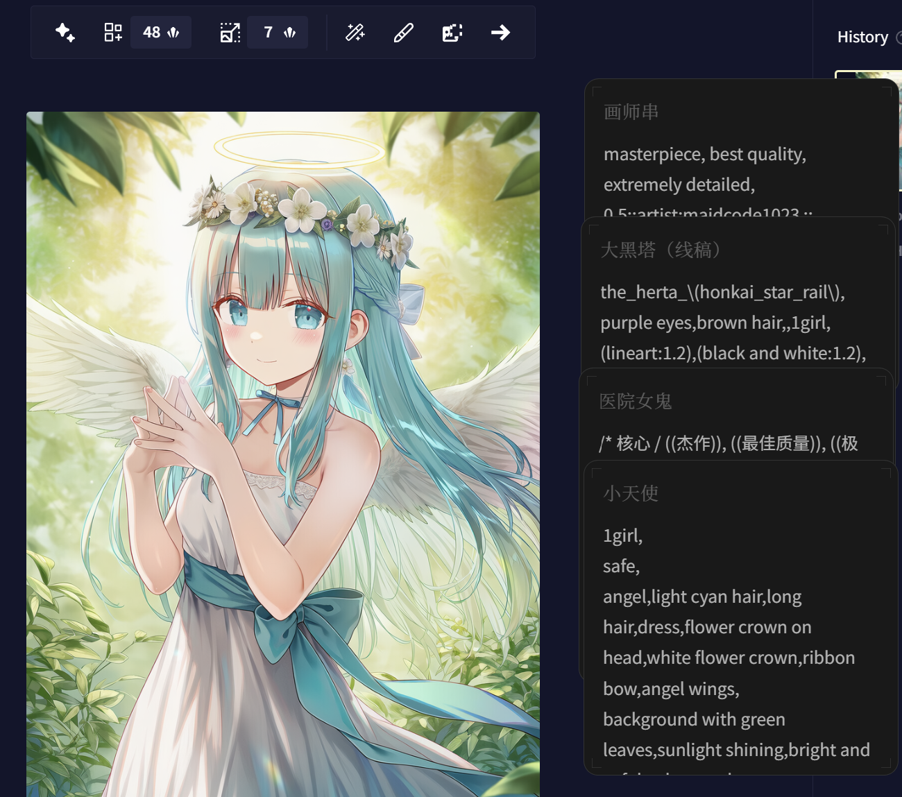

[简体中文](README.md) | [繁體中文](README_zh-HK.md) | **English**

<!-- markdownlint-disable -->

# DeskMate

A lightweight, elegant, and modern sticky note app for your desktop 
Built with Tauri 2 + React

[Report an Issue](https://github.com/Ahazjh/DeskMate/issues) · [Changelog](https://github.com/Ahazjh/DeskMate/releases)  
[Quick Start](#quick-start) · [FAQ](https://github.com/Ahazjh/DeskMate/wiki) · [Building from Source](#building-from-source)

 

 

<!-- markdownlint-restore -->

---

## Why DeskMate

Most note-taking or sticky note apps out there are either bloated and steep to learn, or dated and long abandoned. DeskMate was built to be different — quick to summon, light to use, and a pleasure to look at.

## Features

- **Markdown Editing & Preview** — Full GitHub Flavored Markdown support with seamless toggling between edit and preview modes

  

- **Quick Note** — Summon a note window instantly from the system tray or via a global hotkey (default: `Ctrl+Space`)

  

- **Pin Mode** — Pin a note to a fixed spot on your desktop for quick reference and easy copying

  

- **Import & Export** — Import and export notes as `.md` files

## Use Cases

- Use it as an always-visible clipboard to stash and copy text on the fly
- Jot things down while gaming or watching videos
- Capture a quick thought or burst of inspiration
- Keep a to-do list right on your desktop

## Quick Start

### Download

#### Via GitHub

Head over to the [Releases page](https://github.com/Ahazjh/DeskMate/releases/latest) to download.

##### Download Reference

| Platform | Arch                    | Type                    | Filename                                 |
| -------- | ----------------------- | ----------------------- | ---------------------------------------- |
| Windows  | x64                     | Installer (Recommended) | deskmate_x.y.z_x64-setup.exe     |
| Windows  | x64                     | Portable                | deskmate_x.y.z.exe               |
| Windows  | x64                     | MSIX Package            | deskmate_x.y.z_x64.msix          |
| Windows  | AArch64                 | Installer (Recommended) | deskmate_x.y.z_aarch64-setup.exe |
| Windows  | AArch64                 | MSIX Package            | deskmate_x.y.z_aarch64.msix      |
| macOS    | AArch64 (Apple Silicon) | DMG                     | deskmate_x.y.z_aarch64.dmg       |
| macOS    | x64 (Intel)             | DMG                     | deskmate_x.y.z_x64.dmg           |

#### Via Microsoft Store

Download DeskMate from the [Microsoft Store](https://apps.microsoft.com/detail/9NRCC0ZSG81R)

> Note: MSIX installs (from the Microsoft Store or sideloaded .msix files) do not support in-app updates. Get the latest version from the Microsoft Store or GitHub Releases.

<!-- markdownlint-disable -->

<!-- markdownlint-restore -->

#### macOS Installation Guidance

If you encounter installation issues, please refer to:

- Wiki: [macOS Installation Guidance](https://github.com/Ahazjh/DeskMate/wiki/macOS-%E5%AE%89%E8%A3%85%E6%8C%87%E5%BC%95-%7C-macOS-Installation-Guidance)
- Or video (Bilibili): [Mac云课堂 - Installing software on Mac means learning to wrestle with Apple](https://www.bilibili.com/video/BV1tg411t7hN)

### Building from Source

Please refer to [CONTRIBUTING.md](CONTRIBUTING.md).

## Star History

## 🌟 Contributors

## Sponsors

<!-- markdownlint-disable -->

|  | Free code signing provided by [SignPath.io](https://signpath.io), certificate by [SignPath Foundation](https://signpath.org/) |
| -------------------------------------------------------------------------------- | ----------------------------------------------------------------------------------------------------------------------------- |

<!-- markdownlint-restore -->

## License

[MIT](LICENSE)
